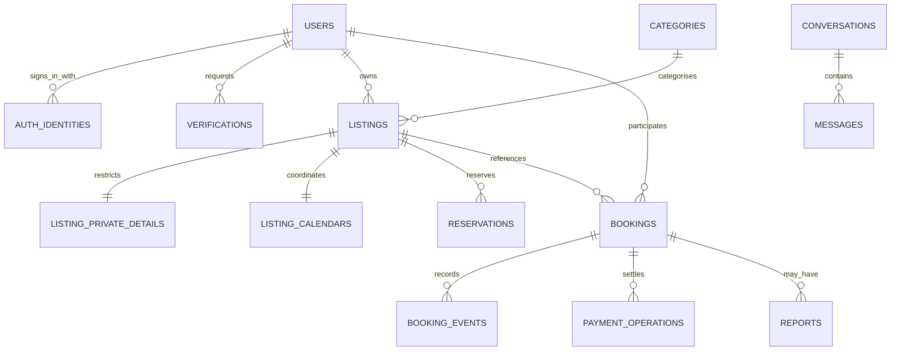

# Rentigo Database Design

Version 0.1 | 14 November 2026 | Implementation specification

## Scope and decision precedence

This document and API_DESIGN.md refine PRD.md and SYSTEM_DESIGN.md. For account access and identity verification, these newer documents supersede the earlier invite-only and undecided sign-in proposals.

Confirmed: MongoDB Atlas managed database; one Next.js/Node.js application; username/password and Google sign-in; both owners and renters need successful external identity verification before publishing or booking; accepted identity options are Aadhaar OR PAN, subject to provider capability. The founder is the initial admin, manages initial users and permissions, and reviews reports. The admin does not manually authenticate government documents.

Proposed defaults requiring product approval: rentals of 2–10 rolling 24-hour days, one-hour payment reservation, and a 24-hour inspection window after actual return. Owner response expiry and cancellation fees remain undecided. No blanket age restriction was approved; independent transaction eligibility for minors remains unresolved and must be settled before paid launch. An ID or a verified badge alone does not establish contractual eligibility.

Money is simulated until a provider and operational policies are approved. Test verification must never produce a real Identity verified badge.

## Storage conventions

- Use ObjectId internally; expose opaque string identifiers in JSON.
- All records have _id, createdAt, updatedAt, and schemaVersion. Mutable business records also have version for optimistic concurrency.
- Store money as nonnegative integer paise and currency INR; use integer-safe arithmetic and upper bounds.
- Use BSON UTC dates; display in Asia/Kolkata. Rental intervals are [startAt, endAt), permitting adjacent bookings unless a later turnaround buffer is adopted.
- API inputs and stored field names follow this document. Never persist arbitrary request bodies.
- No raw passwords, card details, Aadhaar/PAN numbers, or government-document images in application records or logs. Prefer provider-hosted document collection.
- Relationships are application-enforced references. Use archival for records referenced by bookings.

## Relationship overview

## Collections

### users

Fields: displayName, usernameNormalized optional, emailNormalized optional, emailVerifiedAt optional, avatarUrl optional, roles (user/admin), accountStatus (active/suspended/closed), identityStatus (unverified/pending/verified/rejected/expired), verifiedIdentityReference optional, eligibilityStatus (pending/eligible/restricted), version.

A user can both own and rent. Identity status is backend-managed and cannot be edited through profile APIs. An admin-created account starts unverified; admin role does not bypass identity requirements for rentals. Do not infer eligibility from document possession.

Indexes: unique partial usernameNormalized; unique partial emailNormalized; accountStatus plus createdAt. Partial indexes apply only where values are strings. Account-linking rules must not silently merge identities based only on an untrusted email claim.

### authIdentities and sessions

Auth identity fields: userId, provider (credentials/google), providerSubject, passwordHash only for credentials, passwordChangedAt optional. Use the auth library's supported password hashing and session mechanisms; never reversible encryption for passwords.

Indexes: unique (provider, providerSubject), userId. Auth-library session records hold hashed or otherwise library-protected session tokens and expiry; TTL expiry is cleanup, while request-time expiry remains authoritative. Reset and activation tokens are hashed, one-use, and time-limited. Admin-created users activate their own credentials; do not distribute shared default passwords.

### verifications

Fields: userId, provider, providerSessionId, environment (test/live), requestedDocumentType (aadhaar/pan), status (created/pending/verified/rejected/expired/cancelled), consentVersion, consentedAt, verifiedAt optional, expiresAt optional, outcomeCode optional, providerReference, providerEventVersion optional.

Indexes: unique (provider, environment, providerSessionId); userId plus createdAt. Maintain at most one active verification attempt per user with an atomic guard. Store only minimal provider outcome data, never arbitrary webhook bodies. A successful live, person-matched outcome can update users.identityStatus. Test outcomes stay separate and have no real authorisation effect.

Aadhaar/PAN workflows depend on an approved provider. Number lookup or document upload alone is not a successful identity check. Prefer retaining outcome/reference rather than identity document content.

### categories

Fields: slug, name, active, sortOrder. Unique slug index. Inactive categories retain historical references. The allowed-item policy remains a launch requirement, including a decision on mobility aids.

### listings

Fields: ownerId, categoryId, title, description optional, condition {status: working_well/has_issues, note}, photos [{assetId, publicUrl, width, height}], dailyRatePaise, depositPaise, approximateValuePaise, currency, areaLabel, approximateLocation (GeoJSON Point), status (draft/active/paused/archived/hidden), version.

Required to publish: title, category, at least one current photo, basic condition, price, deposit, value, approximate location, and availability configuration. Require a note for has_issues. Proposed limit: five photos. Validate all financial fields and location ranges. Coordinates are [longitude, latitude].

Indexes: approximateLocation 2dsphere; (ownerId, status, createdAt); (categoryId, status, createdAt). Basic text search over title/description may be used separately. MongoDB text and geospatial operators have combination restrictions; implement a compatible query strategy and verify query plans rather than assuming $text can be combined with $geoNear. For a small pilot, indexed geospatial candidates plus bounded escaped title matching is acceptable; paginate only after relevant filters.

### listingPrivateDetails

Fields: listingId, ownerId, pickupAddress, pickupInstructions optional, exactLocation optional. Unique listingId. Never included in public listing projections. Access requires listing ownership or an authorised booked rental; payment-pending acceptance alone does not expose the address.

### listingCalendars and reservations

listingCalendars: listingId, revision. Unique listingId. Its revision is the per-item coordination record, not a growing array of all historical bookings.

reservations: listingId, bookingId optional, kind (owner_block/payment_hold/confirmed), startAt, endAt, status (active/released), expiresAt optional, createdBy. Index (listingId, status, startAt, endAt), bookingId. Expired payment holds do not block availability even if cleanup has not run. Do not TTL-delete confirmed reservation history.

All reservation mutations, including owner blocks, take the same transactional coordination path. Within a transaction: increment the listing calendar revision, check active overlaps, write the reservation and related booking transition. Concurrent writers conflict on the calendar record; retry with fresh overlap checks. Confirm transaction support on the chosen Atlas tier before implementation. An in-process lock is insufficient across serverless instances.

### bookingQuotes

Fields: renterId, listingId, listingVersion, startAt, endAt, billableDays, dailyRatePaise, rentalSubtotalPaise, depositPaise, platformFeePaise (0 initially), totalUpfrontPaise, currency, policyVersion, expiresAt.

A quote is a short-lived server calculation, not a reservation. Check expiry in application code; TTL cleanup is optional. Revalidate listing state, identity and eligibility when requesting and accepting a booking. Changes require a new quote or explicit negotiated proposal, never a hidden price change.

### bookings

Fields: listingId, ownerId, renterId, agreedTerms snapshot, activeProposal optional, status, issueStatus, reservationId optional, paymentDueAt optional, pickupConfirmations, returnConfirmations, inspectionDueAt optional, actualReturnAt optional, version.

agreedTerms: itemTitle, startAt, endAt, billableDays, dailyRatePaise, rentalSubtotalPaise, depositPaise, platformFeePaise, totalUpfrontPaise, currency, policyVersion, termsRevision.

status: requested/awaiting_renter_agreement/payment_pending/booked/in_use/return_pending/settlement_pending/completed/declined/cancelled/expired. issueStatus: none/open/under_review/resolved. Overdue is derived from deadline and return state; an unresolved pickup or return is not proof of non-return.

Each party's confirmation contains actorId, confirmedAt, conditionNote optional, evidenceAssetIds optional, and idempotency reference. actualReturnAt is established from mutual agreement or an admin decision when disputed, not an untrusted unilateral timestamp. Silence after a renter's claimed return follows an escalation policy that remains to be approved; do not automatically forfeit or release money without that policy.

Indexes: (ownerId, status, createdAt), (renterId, status, createdAt), (listingId, agreedTerms.startAt, agreedTerms.endAt), (status, paymentDueAt).

### bookingProposals and bookingEvents

Proposals: bookingId, proposedBy, termsRevision, proposedTerms, status (pending/accepted/rejected/superseded), expiresAt optional. Only pre-pickup negotiation is in scope; extensions require a later explicit flow. Accepting a proposal must recheck availability and establish both parties' agreement before payment.

Events: bookingId, sequence, actorType, actorId optional, eventType, previousStatus, nextStatus, reasonCode optional, safeMetadata, createdAt. Unique (bookingId, sequence). Application append-only, without claiming tamper-proof storage. Store business write and event in the same transaction.

### conversations and messages

Conversations: participantIds, listingId, bookingId optional, conversationKey, lastMessageAt. Unique conversationKey constructed from the listing and canonical sorted participant identifiers. A repeated create request returns the existing conversation.

Messages: conversationId, senderId, body, clientMessageId, createdAt. Unique (conversationId, senderId, clientMessageId); index (conversationId, createdAt, _id). Text-only MVP with a length limit; attachments require a later design. Only participants can access messages. Operator access is scoped and audited when required for report review.

### reports and restrictedAssets

Reports: bookingId, reporterId, category (non_return/damage/item_mismatch/return_refused/behaviour/other), description, evidenceAssetIds, status (open/under_review/resolved/closed), assignedAdminId optional, decision optional.

Decision: outcomeCode, reason, decidedBy, decidedAt, linkedFinancialOperationIds. Do not confuse an administrative finding with a successful provider refund.

restrictedAssets: ownerId, purpose, providerAssetId, accessPolicy, expiresAt optional. Private report evidence uses authenticated delivery or short-lived authorised URLs, never public listing-photo URLs. Government ID collection belongs in the provider flow, not this collection.

### paymentOperations and providerEvents

Operations: bookingId, environment (test/live), type (collection/deposit_release/refund/owner_payout), amountPaise, currency, status (created/pending/succeeded/failed/cancelled), provider, providerReference optional, idempotencyKey, reasonCode, createdAt, updatedAt.

Unique (environment, idempotencyKey); unique partial (provider, environment, providerReference). Keep rental income, deposit liability, refunds and payouts distinct in allocation fields. A provider-dependent deposit release may not be the same as a monetary refund. Validate cumulative refunds/deductions against confirmed collected amounts. A complete financial ledger and reconciliation design is required before real money.

providerEvents: provider, environment, eventId, eventType, safeReference, processingStatus, attempts, receivedAt, processedAt. Unique (provider, environment, eventId). Record verified receipt, then apply business changes transactionally; retry pending/failed processing. Out-of-order events must not regress confirmed financial states.

### auditEvents and idempotencyRecords

Audit: actorId, action, targetType, targetId, reason, createdAt. Record role changes, account restrictions, verification decisions from providers, and report decisions. Never store secrets or identity numbers in metadata.

Idempotency: actor/scope, key, requestHash, state, safeResponseReference, expiresAt. Unique (scope, key). A reused key with a different body returns a conflict. Apply to booking creation/acceptance, confirmations, and money operations.

## Permissions

| Action | Required condition |
| --- | --- |
| Browse public listings | No account required |
| Message | Active signed-in account; participant membership |
| Publish listing | Active account, live verified identity, eligible transaction status |
| Request or accept rental | Same checks for acting user; both parties must qualify before payment |
| Confirm pickup or return | Booking participant, valid state; suspension must not prevent returning an existing item |
| View pickup details | Owner or authorised booked renter |
| Review report or change roles | Admin role, audited action |

Client UI checks are convenience only; services enforce permissions on every mutation. Do not conflate admin-created accounts with verified identity.

## Lifecycle, retention and open dependencies

Do not cascade-delete booking evidence or financial history when a user closes an account. Establish retention and deletion policies before public launch; no indefinite default retention of sensitive evidence. Use selected-field projections and redact logs.

Backups and restoration must be verified on the actual Atlas plan. Test concurrent acceptance, payment retry, duplicate webhooks, address access, account linking and return disputes before the paid pilot.

Open: identity provider, contractual eligibility including minors, cancellation policy, owner request expiry, exact inspection escalation, settlement timing, failed/late-payment recovery, and production financial accounting. These are launch gates, not assumptions that a verified badge resolves them.
