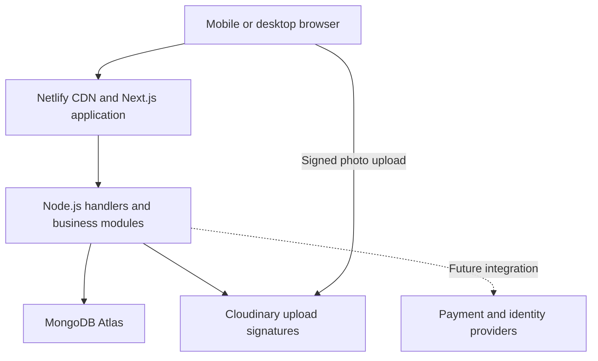

# Rentigo System Design and Tech Stack

Version 0.1 | 14 November 2026 | Proposed implementation baseline

## Purpose

Describe how to build Rentigo as a simple modular monolith for a Vijayawada neighbourhood rental pilot. Read this document alongside the product requirements document. This design retains platform-managed payments as a future requirement and uses simulated money movement in the first prototype.

## Architecture decision

Use one Next.js application, one Git repository, and one coordinated deployment. React pages and Node.js backend handlers share server-side business modules. MongoDB Atlas manages the database; Cloudinary stores listing photos.

Deploy initially to Netlify Free. Netlify runs dynamic Next.js features using its managed runtime and functions; this is a monolith at the code and deployment level, not a permanently running Node.js process. No separate Express service, microservices, Redis, or message broker is needed for the prototype.



## Stack

| Layer | Choice | Purpose |
| --- | --- | --- |
| Application | Next.js App Router and TypeScript | UI, rendering, HTTP handlers, shared types |
| UI | React and Tailwind CSS | Mobile-first forms and screens |
| Runtime | Supported Node.js LTS compatible with chosen Next.js release | Backend execution |
| Validation | Zod | Server-side input validation |
| Database | MongoDB Atlas Free | Managed application records |
| Database client | Official MongoDB Node.js driver | Queries, indexes, transactions where supported |
| Authentication | Established session/auth library; provider selection pending | Secure sign-in without custom authentication protocols |
| Images | Cloudinary Free | Persistent image storage and delivery |
| Hosting | Netlify Free | Git-based builds, CDN, Node.js functions |
| Payments | Mock adapter initially | Simulated collection, refund, and payout |

Pin compatible dependency versions during implementation rather than relying on floating latest versions.

## Free hosting decision and limits

Netlify replaces the earlier Render recommendation because the user rejected Render's approximately one-minute wake-up delay. Netlify Free permits commercial projects and currently includes 300 monthly credits. Requests, compute, deployments, and other metered usage consume the allowance. Free projects pause when credits run out.

This choice avoids Render's particular sleeping-service behaviour. It does not guarantee zero cold starts or a response-time service level. Measure the deployed application, including database connection time, before inviting users. An always-warm dedicated server is not promised at zero cost.

Use the provided Netlify subdomain initially. A purchased custom domain is optional and outside the zero-cost baseline. Do not activate paid plans or auto-recharge to meet the prototype scope. Check account-specific quotas and alerts before deployment.

Atlas Free has storage, connection, and throughput limits. Cloudinary Free currently provides 25 monthly credits shared across storage, transformations, and delivery. Images must not be stored in MongoDB or the application's local filesystem. Start with at most five compressed images per listing, subject to product review.

The zero-cost target covers limited prototype infrastructure. It does not guarantee free payment processing, SMS, identity checks, indefinite growth, or production availability. Do not use frequent polling or artificial keep-alive requests to compensate for hosting limitations.

## Internal module boundaries

- Accounts and access: sessions, roles, invite approval, profile and verification states.
- Listings: creation, edits, photos, categories, approximate location, availability.
- Discovery: keyword/category/date filters and nearby results.
- Bookings: agreed terms, reservations, handover, returns, and state transitions.
- Messaging: item conversations and booking conversations.
- Reports: evidence, account restrictions, and review history.
- Payments: provider-independent operations, initially simulated.

Handlers validate input and sessions, then call business services. Services enforce rules and call database repositories. Server-rendered pages can call services directly instead of making HTTP requests back into the same application. Database credentials and provider secrets remain server-only.

Suggested structure:

```text
src/
  app/                 Pages, layouts, and route handlers
  components/          Shared UI
  server/
    modules/           Accounts, listings, bookings, messages, reports, payments
    db/                Shared MongoDB client and index definitions
    auth/              Sessions and access checks
  lib/                 Safe shared utilities and schemas
docs/
  PRD.md
  SYSTEM_DESIGN.md
```

## Data model

| Collection | Main records |
| --- | --- |
| users | Display name, authentication identity, approval state, roles, verification states |
| invitations | Hashed invite token, expiry, usage and approving user |
| listings | Owner, title, category, photos, basic condition, prices, approximate point, status |
| listingPrivateDetails | Restricted exact pickup location and instructions |
| listingCalendars | Owner blocks and per-item reservation coordination |
| bookings | Parties, dates, immutable agreed terms, current stage, confirmation timestamps |
| bookingEvents | Append-only transition history, actor, reason and timestamp |
| conversations | Participants and listing/booking reference |
| messages | Conversation, sender, content and timestamp |
| reports | Reporter, booking, reason, restricted evidence references, review outcome |
| paymentRecords | Simulated or provider operations, amount, status, unique operation key |

Store money as integer paise and currency as INR. Store timestamps in UTC and display dates in Asia/Kolkata. Do not store identity document copies, raw card data, or reusable payment credentials.

Booking terms snapshot the agreed daily rate, rental subtotal, deposit, dates, return deadline, and applicable policy version. Editing a listing must not alter an existing agreement. Rental day rounding and partial-day rules remain a product decision.

## Nearby discovery

Use an approximate GeoJSON point on each listing with a MongoDB 2dsphere index. Support manual Vijayawada area selection when location access is declined. This avoids requiring a paid address-autocomplete API in the prototype.

Filter by listing visibility, category, keyword, and requested dates; order nearby results by distance and paginate them. Do not take a small nearest-results page and only then remove unavailable items, as that can hide valid matches. Public responses never include exact pickup addresses. Exact locations require a permitted booking relationship.

Start with indexed basic keyword search rather than a separate search service. Index messages by conversation and creation time; bookings by listing/dates and each participant/status. Review query plans using realistic pilot data.

## Booking consistency

Use one server-side state machine. Requests do not reserve an item until acceptance. Revised terms require renter acceptance. Every mutation verifies the actor, current stage, and expected version.

Prevent double booking through database coordination, not an in-memory lock or a separate availability check followed by an unprotected insert. A proposed implementation serialises booking acceptance and owner date blocks by updating the listing's calendar coordination document within the same transaction as the overlap check and booking write. Retry write conflicts and recheck availability. All operations that reserve dates must follow this path. Confirm transaction compatibility on the selected Atlas tier and test simultaneous acceptance before deployment.

Use half-open rental intervals so one booking may end when another begins, subject to any later turnaround buffer. Payment-pending reservations have explicit expiry timestamps. Expired holds must be ignored by availability logic even if cleanup has not run.

Normal states: requested, awaiting renter agreement, payment pending, booked, in use, return pending, settlement pending, completed. Declined and cancelled are terminal alternatives. Overdue and issue reported are additional flags.

Both parties confirm handover and return. One confirmation cannot silently complete a contested booking. Financial outcomes are never decided solely by one participant's claim.

## Authentication and user reliability

Authentication proves control of an account; it does not establish identity or future reliability. The selected baseline for the prototype is invite-only neighbourhood access with manual membership approval. A specific sign-in provider is still pending; Google sign-in is a possible convenience, not an identity check.

Keep separate states for contact verification, identity checks, community approval, completed rentals, and account restrictions. Show specific evidence such as completed rental counts rather than a general trustworthy badge.

Before opening to the general public, evaluate a suitable identity-verification provider and its costs. Lower-value first-rental limits and transaction-linked reviews are proposed safeguards. Do not assume identity verification or SMS will fit a permanent free allowance. Community approval and identity checks do not replace dispute handling.

## Messaging and notifications

Store conversations in MongoDB. Initially fetch new messages periodically only while the conversation is visible, stop polling in background tabs, and use backoff. Tune the interval against hosting credits; avoid a dedicated WebSocket service initially.

Provide in-app booking updates. Calculate overdue status from saved deadlines on reads. Do not rely on an in-process timer for return reminders or hold expiry: functions may terminate. Guaranteed scheduled reminders require a separately evaluated scheduler or provider. Exact-time SMS and email delivery are not part of the zero-cost prototype commitment.

## Uploads and privacy

The backend issues short-lived upload authorisation after checking the user and listing. Upload images directly to Cloudinary with type, size, and count limits. Keep provider secrets private. Track uploaded assets so failed listing creation and deletions can be cleaned up.

Listing photos can be public. Report evidence must use appropriately restricted delivery; do not place dispute images at publicly shared listing URLs. Apply participant and operator access checks to messages, booking records, exact addresses, and reports.

Use secure HttpOnly session cookies, appropriate SameSite settings, origin checks on mutations, server-side validation, persistent rate limits for abuse-sensitive routes, and explicit role checks. Do not depend on per-process memory for durable rate limits. Redact tokens, sensitive addresses, and provider payloads from logs.

## Future payment integration

Define an adapter with operations for creating a payment, reading status, arranging a refund, and requesting an owner payout. Actual deposit mechanics depend on the selected provider; do not promise escrow, bank-account freezing, or indefinitely valid card holds.

In the prototype, all financial screens and records clearly state simulated. No real collection occurs.

For real payments, trust verified provider webhooks rather than browser redirects. Verify signatures, deduplicate provider events, and make operations idempotent. Record rent, deposit, refund, and payout separately. Include reconciliation for delayed or missed events. Reservation expiry and late payment confirmation need an explicit recovery path.

Payment-provider selection, identity verification, inspection deadlines, cancellations, non-return, and disputed deductions must be resolved before activating paid rentals. A reviewer or external service must own contested cases; automation cannot remove this requirement.

## Deployment and operations

Connect the GitHub repository to Netlify after deployment is authorised. Keep secrets in the hosting environment, never in Git. Provide an example environment file with placeholder names only. Use separate development data and production data, and prevent preview deployments from mutating pilot records.

Reuse the MongoDB client within warm function instances, use bounded connection pools, and select compatible hosting/database regions where available. Restrict database network access as far as the hosting plan permits and document any compromise rather than silently opening access broadly.

Run type checks, linting, and a production build before deployment. Add focused integration tests for authorisation, simultaneous reservations, negotiated terms, and confirmation transitions. Test webhook retries and payment failures when the real adapter is introduced.

Monitor errors, credit consumption, database usage, and image delivery. Before real users, verify an affordable backup and restore procedure. Never assume a backup feature is included without checking the actual Atlas account.

## Delivery sequence

1. Confirm design decisions and authentication approach.
2. Create the monolith foundation, database client, and access controls.
3. Implement listings, images, and nearby search.
4. Implement requests, terms, reservations, and simulated payments.
5. Implement messaging, handover, returns, and reports.
6. Deploy a private prototype, measure cold-start and normal response times, and assess quota consumption.
7. Resolve operational and provider decisions before a real-money pilot.

## Remaining decisions

- Initial sign-in provider and invitation approval process.
- Allowed item categories and new-renter value limits.
- Daily charge calculation, cancellation and inspection windows.
- Who reviews abuse reports and contested bookings.
- Payment and identity providers and their budget.
- Measured response-time target and acceptable free-quota trade-offs.

## Reference documentation

Plan information checked on 14 November 2026; limits and eligibility can change.

- [Netlify pricing](https://www.netlify.com/pricing/)
- [Netlify commercial use on Free](https://www.netlify.com/blog/introducing-netlify-free-plan/)
- [Next.js on Netlify](https://docs.netlify.com/build/frameworks/framework-setup-guides/nextjs/overview/)
- [MongoDB Atlas Free limits](https://www.mongodb.com/docs/atlas/reference/free-shared-limitations/)
- [Cloudinary billing and plans](https://cloudinary.com/documentation/billing_and_plans)
